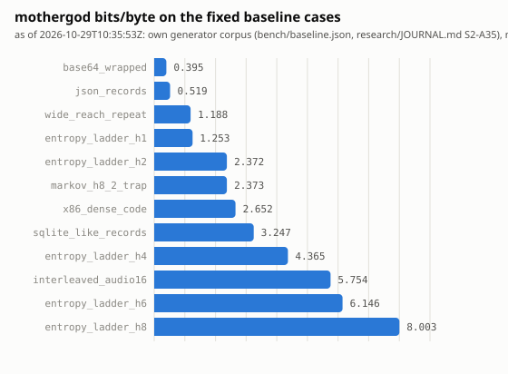

<!-- Generated by `cargo run -p mothergod-bench --release --bin render_baseline_graph`. Do not hand-edit; re-run the generator instead. -->

# Baseline snapshot

As of 2026-10-20T15:45:22Z. Source: `bench/baseline.json`, measured by `mothergod::compress` on 12 fixed-seed cases, each 50000 bytes except `wide_reach_repeat`, 1376256 bytes (`research/JOURNAL.md` S2-A35) — mothergod's own generator corpus, not the pinned Silesia/Canterbury held-out finals. No gzip/zstd/xz comparison here: this table is mothergod against itself, run over run; see `docs/benchmarks/canterbury.md` for real numbers against the pinned reference compressors on the Canterbury held-out final (`research/JOURNAL.md` S2-A37).

| case | bits/byte |
|---|---|
| `base64_wrapped` | 0.395360 |
| `json_records` | 0.519360 |
| `wide_reach_repeat` | 1.187756 |
| `entropy_ladder_h1` | 1.253120 |
| `entropy_ladder_h2` | 2.372480 |
| `markov_h8_2_trap` | 2.372640 |
| `x86_dense_code` | 2.651840 |
| `sqlite_like_records` | 3.246720 |
| `entropy_ladder_h4` | 4.365120 |
| `interleaved_audio16` | 5.754400 |
| `entropy_ladder_h6` | 6.145920 |
| `entropy_ladder_h8` | 8.002880 |
